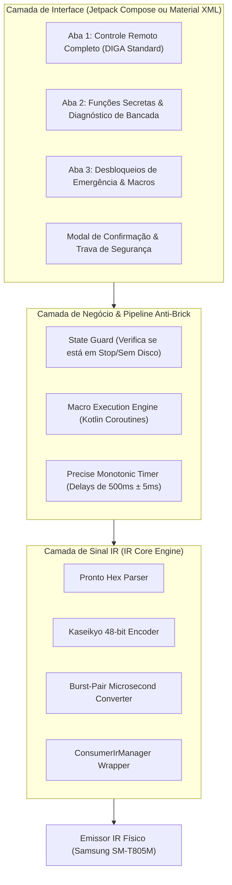

# 📱 Panasonic DIGA Commander — Especificação Arquitetural & Plano do Projeto Android IR

> **Status do Documento:** Planejamento Executivo (Plan Mode)  
> **Dispositivo Alvo:** Samsung Galaxy Tab S 8.4 LTE (`SM-T805M`) com emissor infravermelho integrado (*Consumer IR Blaster*)  
> **Aparelhos Compatíveis:** Panasonic DMR-EH55, DMR-EH50, DMR-EH65, DMR-EX768, DMR-ES10/15 e geração DIGA correlata  
> **Linguagem & Ambiente:** Kotlin (Android Nativo / Android Studio)

---

## 1. Dossiê Completo de Hacks, Códigos Secretos e Procedimentos de Bancada

Abaixo está o mapeamento exaustivo e verificado de todos os comandos e procedimentos documentados na literatura técnica e manuais de serviço Panasonic (*Panasonic Service Manual DMR-EH55EC / DMR-EH50*):

### 1.1 Entradas de Serviço e Diagnóstico (Service Mode)

O **Service Mode** do microprocessador Renesas SH-4 e do sub-controlador periférico da Panasonic é acessado de duas formas:
1. **Via Painel Frontal (Modo Físico):**
   Com o aparelho em **STOP** (sem reprodução, gaveta vazia):
   $$\mathbf{[STOP]} + \mathbf{[PLAY]} \quad \text{por 5 segundos}$$
2. **Via Infravermelho (Comando de Serviço Remoto):**
   Disparo da sequência de códigos de teste da Panasonic (equivalente ao controle de serviço oficial *Panasonic Service Remote*).

Uma vez no **Service Mode**, o display fluorescente frontal (VFD/FLD) responde aos comandos numéricos do controle:

| Código Remoto | Nome da Função | O que faz / O que o display (VFD) exibe | Nível de Risco |
| :--- | :--- | :--- | :--- |
| **`4` `1`** | **Laser Used Time (Horímetro)** | Exibe o tempo total acumulado em horas de emissão do diodo laser (ex: `L0185` = 185 horas). Crucial para avaliar a saúde da cabeça óptica do gravador antes e após capturas. | **Zero** (Leitura) |
| **`0` `1`** | **Error History (Histórico de Falhas)** | Percorre os códigos de erro gravados na EEPROM (`U**`, `H**`, `F**`), permitindo identificar falhas de buffer, erros de barramento IDE ou superaquecimento passado. | **Zero** (Leitura) |
| **`0` `2`** | **Region Code Readout** | Exibe por 5 segundos no painel a região do DVD gravada na placa (`04` para Brasil/América Latina, `01` EUA, `02` Europa ou `00` após multi-região). | **Zero** (Leitura) |
| **`3` `1`** | **HDD Surface / Drive Integrity** | Dispara o teste interno de varredura de integridade física dos setores do disco rígido e realocação automática de setores defeituosos no MEIHDFS. | **Baixo** (Não destrutivo) |
| **`0` `0`** | **VFD All-Segments Test** | Acende simultaneamente 100% dos segmentos e ícones do display frontal para diagnóstico de filamentos e trilhas do CI de display. | **Zero** (Visual) |
| **`8` `1`** | **I/O & Video Output Test** | Força a alternância de padrões de teste para validação de barramento RGB/Componente/S-Video. | **Zero** (Diagnóstico) |
| **`9` `9`** | **Factory Re-initialization (Hard Reset)** | Pressionar `9` `9` dentro do Service Mode limpa toda a NVRAM/EEPROM e restaura as configurações de fábrica do gravador. | **Médio** (Limpa ajustes) |

*Para sair do Service Mode com segurança:* Transmitir o comando **`[POWER]`**.

---

### 1.2 O Hack Multi-Região (DVD Region Free via IR Macro)

Os gravadores Panasonic da geração DIGA não possuem menu na tela para alteração de região. A troca para **Região 0 (Multi-Região)** é realizada através de uma injeção de sequência de pulsos no barramento IR com intervalo de tempo rigoroso.

#### A Sequência de Macro Homologada:
Com o aparelho **ligado** e a **gaveta do DVD vazia** (sem disco):

$$\mathbf{1} \xrightarrow{500\text{ms}} \mathbf{2} \xrightarrow{500\text{ms}} \mathbf{3} \xrightarrow{500\text{ms}} \mathbf{4} \xrightarrow{500\text{ms}} \mathbf{5} \xrightarrow{500\text{ms}} \mathbf{6} \xrightarrow{500\text{ms}} \mathbf{7} \xrightarrow{500\text{ms}} \mathbf{8} \xrightarrow{500\text{ms}} \mathbf{9} \xrightarrow{500\text{ms}} \mathbf{0} \xrightarrow{500\text{ms}} \mathbf{AUDIO} \xrightarrow{500\text{ms}} \mathbf{MEDIA\_SERVER}$$

* **Comportamento Esperado:** O gravador reinicia automaticamente ou o display exibe brevemente uma confirmação (como `1B` ou `00`).
* **Verificação Pós-Hack:** Entrar no Service Mode (`STOP` + `PLAY` por 5s) e apertar `0` `2`. O display deve acusar região livre.

---

### 1.3 Comandos de Emergência, Desbloqueio e Manutenção

* **Destravar "CHILD LOCK / X-HOLD / LOCKED":**
  * Ocorre quando o usuário ou uma criança ativa a trava do painel. Nenhum botão físico do aparelho responde.
  * *Comando de Desbloqueio:* Segurar a tecla **`[ENTER]`** (ou `[RETURN]`) do controle remoto apontada para o aparelho por **5 segundos contínuos**.
* **Ejeção Forçada de Gaveta Emperrada (Force Tray Eject):**
  * *Sequência no painel:* Desligar o aparelho; segurar simultaneamente **`[STOP]` + `[CH UP]`** por 5 segundos. O microcontrolador dispara pulso de sobrecorrente no motor de carregamento para forçar a abertura mecânica.
* **Aging Mode (Modo de Estresse Mecânico):**
  * Utilizado na fábrica para testar o desgaste de engrenagens do drive óptico: Em Standby, segurar **`[STOP]` + `[REC]` por 5 segundos**. O aparelho entra em ciclo perpétuo de ejeção/fechamento e foco do laser. Sair pressionando **`[POWER]`**.
* **Desativação do TVGOS (Bypass de Busca Noturna / Desgaste de HDD):**
  * O sistema *TV Guide On Screen* liga o HDD às 3h da manhã procurando sinais analógicos extintos.
  * *Bypass:* Acessar *TV Guide Setup -> Change System Settings -> Zip Code* e programar **`00000`** ou **`99999`**.

---

## 2. Engenharia do Protocolo Infravermelho Panasonic & Pronto Hex

### 2.1 Especificação Física do Protocolo Kaseikyo / Panasonic

Os gravadores Panasonic utilizam a especificação de codificação **Kaseikyo (Panasonic 48-bit)**:
* **Frequência da Portadora (*Carrier Frequency*):** $36.7\text{ kHz}$ a $38.0\text{ kHz}$ (frequência ideal: **$37.010\text{ kHz}$** ou **$38.000\text{ kHz}$**).
* **Pulso de Cabeçalho (*Header/Lead-in*):**
  * Mark (LED ligado): $\approx 3.456\,\mu\text{s}$ ($128$ ciclos a $37\text{ kHz}$)
  * Space (LED desligado): $\approx 1.728\,\mu\text{s}$ ($64$ ciclos a $37\text{ kHz}$)
* **Bit Lógico `0`:**
  * Mark: $\approx 432\,\mu\text{s}$ ($16$ ciclos)
  * Space: $\approx 432\,\mu\text{s}$ ($16$ ciclos)
* **Bit Lógico `1`:**
  * Mark: $\approx 432\,\mu\text{s}$ ($16$ ciclos)
  * Space: $\approx 1.296\,\mu\text{s}$ ($48$ ciclos — proporção $3:1$)
* **Trailer / Stop Bit:** Mark de $432\,\mu\text{s}$ seguido de pausa de repouso ($\approx 74\text{ ms}$ a $100\text{ ms}$).

### 2.2 Conversão de Formato: Pronto Hex $\rightarrow$ `ConsumerIrManager` (Microssegundos)

O Android gerencia o hardware infravermelho nativo através da classe:
`android.hardware.ConsumerIrManager.transmit(carrierFrequency: Int, pattern: IntArray)`

Onde `pattern` é um vetor alternado de **durações em microssegundos**:
`[mark_µs, space_µs, mark_µs, space_µs, ...]`

Para converter qualquer código Pronto Hex (como os do repositório `DMP-BD83dvdmultihack` ou fóruns AVForums):
1. **Palavra 0 (`0000`):** Modo Raw Learned.
2. **Palavra 1 (`freq_code`):** Frequência $f = \frac{1.000.000}{\text{freq\_code} \times 0.241246}\text{ Hz}$. (Ex: `0070` hex = 112 dec $\rightarrow 37.010\text{ Hz}$).
3. **Palavra 2 & 3:** Contagem de pares da sequência inicial e repetida.
4. **Palavras 4 em diante:** Duração de cada estado em número de ciclos de clock da portadora.
   $$\text{Duração em microssegundos} = \frac{\text{palavra\_hex} \times 1.000.000}{f}$$

---

## 3. O Hardware: Samsung Galaxy Tab S 8.4 LTE (`SM-T805M`)

O tablet selecionado é perfeito para a tarefa:
* **Sensor IR:** Emissor infravermelho consumidor (*Consumer IR LED*) embutido na lateral do gabinete.
* **Driver de Hardware:** Suportado nativamente pelo kernel Samsung através do serviço `ConsumerIrManager` da AOSP (introduzido na API 19 — Android 4.4 KitKat).
* **Requisitos de Manifest do Android:**
  ```xml
  <uses-feature android:name="android.hardware.consumerir" android:required="true" />
  <uses-permission android:name="android.permission.TRANSMIT_IR" />
  ```
* **Verificação em Tempo de Execução:**
  ```kotlin
  val irManager = context.getSystemService(Context.CONSUMER_IR_SERVICE) as ConsumerIrManager
  if (!irManager.hasIrEmitter()) {
      // Dispositivo sem hardware IR
  }
  ```

---

## 4. Arquitetura do Software: Projeto Android (Kotlin)

### 4.1 Estrutura em Camadas do Novo Projeto (`DigaCommander`)



### 4.2 Pipeline de Segurança e Proteção Anti-Brick

A gravação de dados incorretos na NVRAM/EEPROM do gravador pode descalibrar o leitor ou travar o bootloader. O aplicativo implementará 4 travas de segurança:

1. **Trava de Confirmação em 2 Etapas (Two-Touch Safety):**
   Comandos que alteram parâmetros permanentes (como *Hard Reset 99* ou *Macro Multi-Região*) exigem desbloqueio de slider ou confirmação modal com aviso explícito.
2. **Temporização Rígida de Fila (*Non-overlapping Dispatcher*):**
   Utilização de um `Mutex` ou canal sequencial de Coroutines (`Channel.CONFLATED` ou fila serial) garantindo que nenhum pulso IR seja emitido antes do término do anterior.
3. **Intervalo Calibrado de 500 ms:**
   O processador SH-4 necessita de uma janela de repouso entre códigos numéricos consecutivos. O envio muito rápido (< 200 ms) causa descarte de dígitos pelo buffer de interrupção, quebrando a macro; o envio muito lento (> 2 s) encerra a janela de autorização. O timer do app rodará em Coroutine de alta prioridade (`Dispatchers.Default`).
4. **Verificação de Frequência de Portadora do Tablet:**
   Antes de transmitir, o app valida se a faixa de $36\text{ kHz}$ a $38\text{ kHz}$ é suportada pelo emissor do tablet via `irManager.carrierFrequencies`.

---

## 5. Estratégia de Desenvolvimento: App Próprio vs. Base Open-Source

Avaliando as alternativas de engenharia para o desenvolvimento:

| Critério | Opção A: Fork do `Twinone IR Remote` (GitHub) | Opção B: Carregar XML no `irplus` Oficial | Opção C: Novo Projeto Kotlin Dedicado (`DigaCommander`) *(Recomendado)* |
| :--- | :--- | :--- | :--- |
| **Complexidade Inicial** | Média (código legado Java/C++ para adaptar) | Baixíssima (apenas criar arquivo XML) | Baixa a Média (código limpo e moderno) |
| **Interface de Usuário** | Genérica de TV/Ar-condicionado | Limitada aos botões de grade do app | **100% personalizada para Panasonic DIGA** (VFD virtual, abas dedicadas) |
| **Travas de Segurança Anti-Brick** | Nenhuma | Nenhuma (qualquer clique acidental dispara) | **Total** (Modais de confirmação, sliders de segurança, logs de auditoria) |
| **Manutenibilidade** | Depende de código de terceiros | Fechado (app binário da Play Store) | **100% sob seu controle**, modular e extensível para novos modelos |
| **Confiabilidade de Macros** | Razoável | Boa | **Perfeita** (Controle por Coroutines e StateFlow) |

> [!TIP]
> **Recomendação Estratégica:**
> 1. **Para teste imediato hoje:** Instale o `irplus` no SM-T805M e importe os dois arquivos `.irplus` do repositório para validar que o hardware infravermelho do tablet aciona o DMR-EH55.
> 2. **Para a solução definitiva profissional:** Crie o projeto dedicado **`DigaCommander`** em Kotlin moderno (Android Studio), com layout sob medida, botões grandes e o pipeline seguro de macros.

---

## 6. Especificação da Árvore de Telas e Componentes do App

### Tela 1: Controle Operacional DIGA (Aba Principal)
* **Bloco Superior:** Power, Drive Select (HDD / DVD / SD), Status, Time Slip.
* **Bloco Central (Navegação):** D-Pad direcional, OK/Enter, Return, Functions (Menu), Direct Navigator, Sub-Menu.
* **Bloco de Transporte:** Play, Stop, Pause, Record, Rec Mode (XP/SP/LP/EP), Skip Fwd/Rev, Slow/Search.
* **Bloco Numérico:** Teclado 0–9 e 10+.

### Tela 2: Diagnóstico de Bancada (Service Mode)
* **Botão Toggle:** Entrar no Service Mode (`STOP` + `PLAY` simulado).
* **Cartão Laser Health:** Dispara comando `41` (Horímetro) com instrução na tela: *"Observe os dígitos L**** no display frontal"*.
* **Cartão Histórico de Erros:** Dispara comando `01` para avançar nos logs `U`/`H`/`F`.
* **Cartão Teste de Disco:** Dispara comando `31` (Surface Scan).
* **Cartão Região Atual:** Dispara comando `02`.
* **Cartão VFD Segments:** Dispara comando `00`.

### Tela 3: Hacks e Recuperação de Emergência
* **Macro Multi-Região (DVD Region Free):**
  * Botão com trava de segurança (deslizar para confirmar).
  * Barra de progresso animada (0% a 100% em 6 segundos, indicando cada dígito transmitido).
  * Botão "Abortar Transmissão".
* **Desbloqueio Child Lock (X-HOLD):** Emite `ENTER` sustentado por 5.000 ms.
* **Guia Interativo TVGOS:** Passo a passo com atalhos de botões para desligar a busca noturna.
* **Ejeção Forçada:** Dispara a sequência de pulso de carga mecânica.
* **Hard Reset de Fábrica:** Protegido por PIN ou confirmação dupla antes do envio de `99`.

---

## 7. Próximos Passos para a Criação do Repositório Separado

Quando for iniciar a implementação do projeto independente no Android Studio:
1. Criar novo projeto: **`PanasonicDigaCommander`** (Template *Empty Activity* com Jetpack Compose ou Views em Kotlin).
2. Configurar `minSdk = 21` (garante compatibilidade com o SM-T805M no Android 5.0/6.0 ou KitKat com minSdk 19) e `targetSdk = 34`.
3. Implementar a classe `ProntoHexConverter` para transformar as strings de hexadecimais em `IntArray` de microssegundos.
4. Conectar a camada de transmissão ao `ConsumerIrManager`.
5. Carregar o dicionário de códigos IR das tabelas documentadas neste plano.
